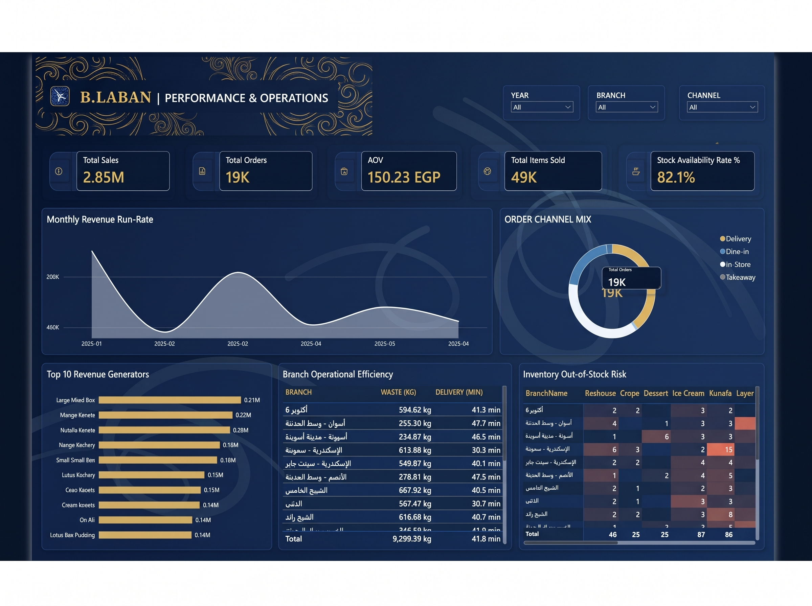

# 🍨 B.Laban | Commercial & Operational Intelligence Suite

<div align="center">

[](https://powerbi.microsoft.com/)
[](https://python.org/)
[](https://www.microsoft.com/sql-server)
[](https://learn.microsoft.com/dax/)
[]()

**Enterprise Retail Analytics, Kitchen Logistics & Supply Chain Resilience**  
*End-to-End Business Intelligence Solution Engineered with Python, SQL, Star Schema & Power BI*

</div>

---

## 📌 Executive Summary

B.Laban operates a fast-paced dessert retail network with aggressive multi-channel fulfillment (Takeaway, Dine-in, Delivery). This project synthesizes end-to-end commercial operations into an executive business intelligence engine to solve three critical business challenges:
1. **Revenue Acceleration & Basket Dynamics:** Monitoring omnichannel revenue milestones and Average Order Value (AOV) across peak hours.
2. **Operations & Kitchen Latency:** Diagnosing branch fulfillment times alongside kitchen scrap/waste tonnage.
3. **Inventory Resilience:** Preempting localized stock-out bottlenecks across core product categories (Kunafa, Ice Cream, Basbousa, Crepe).

---

## 📊 Executive Performance Dashboard

<p align="center">
  
</p>

<p align="center">
  <em>Figure 1.0: Real-time Operational Cockpit displaying Run-Rate trajectory, Channel Split, Product Rankings, Branch Latencies, and Stock-out Matrices.</em>
</p>

### Core Visual Functional Blocks:
* **KPI Ribbon:** Top-level metrics tracking Total Revenue, Orders, Average Order Value, Quantity Sold, and Availability Rate.
* **Monthly Revenue Run-Rate:** Area trendline tracking fiscal trajectories and seasonal peaks.
* **Omnichannel Share:** Dynamic donut chart isolating Takeaway, Dine-in, and Delivery volumes.
* **Revenue Drivers:** Ranked horizontal bar chart highlighting top-performing SKUs.
* **Operational Efficiency:** Branch benchmark matrix evaluating fulfillment time vs. kitchen waste.
* **Out-of-Stock Heatmap:** Color-graded matrix diagnosing localized inventory shortages across product lines.

---

## 🛠️ Data Architecture & Pipeline

```text
┌──────────────────────┐      ┌─────────────────────────┐      ┌────────────────────────┐
│  Raw Data Lakehouse  │ ───► │  Python ETL Engine      │ ───► │  Star Schema Modeler   │
│  (Multi-table CSVs)  │      │  (Pandas Preprocessing) │      │  (Optimized Relations) │
└──────────────────────┘      └─────────────────────────┘      └────────────────────────┘
                                                                           │
                                                                           ▼
                                                               ┌────────────────────────┐
                                                               │  Microsoft Power BI    │
                                                               │  (DAX & Glassmorphic UI)│
                                                               └────────────────────────┘
